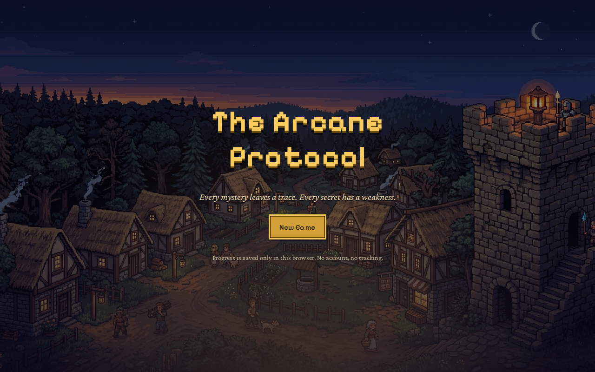
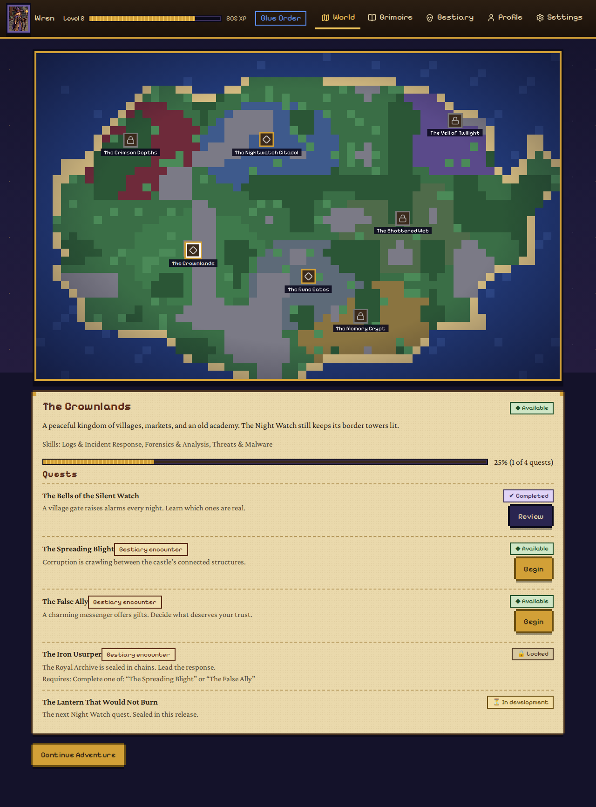
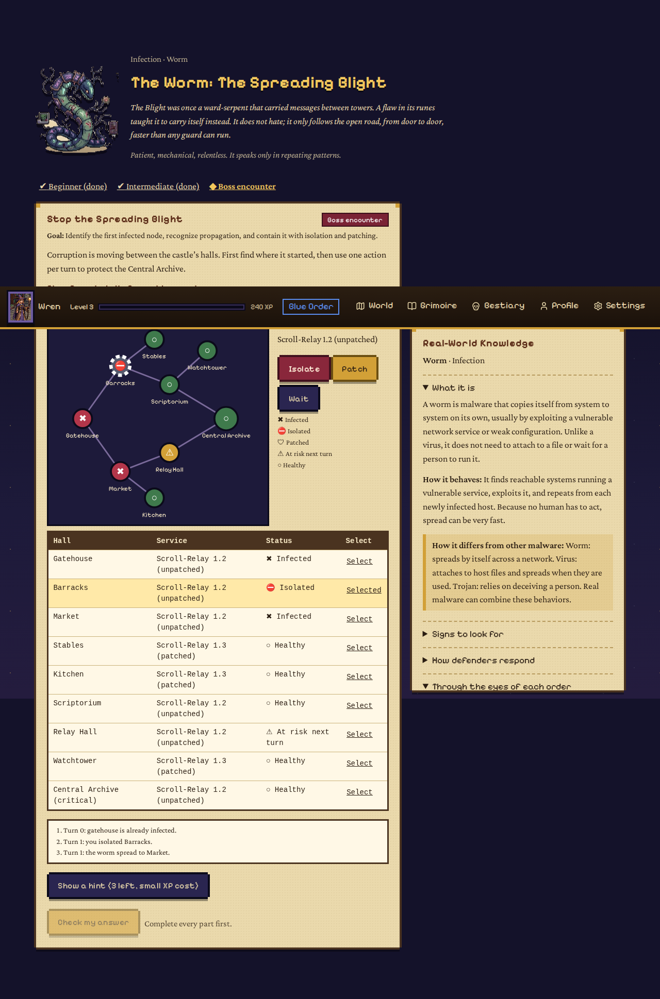
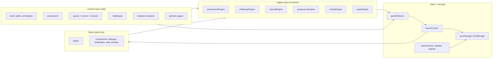
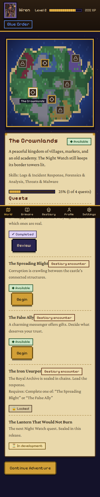

# The Arcane Protocol

> *Every mystery leaves a trace. Every secret has a weakness.*

A pixel-art medieval fantasy RPG that teaches real cybersecurity. You investigate a haunted border village, learn to read logs and timelines, and then face the **Malware Bestiary**: fantasy creatures that each stand for a real kind of malware, with accurate definitions, indicators, and defenses.

Everything runs in the browser, offline, with no account, no backend, no analytics, and no paid service.



## Status: what is and is not built

This is a **vertical slice**, not the full game. Be sure of what you are getting.

| Area | Status |
|---|---|
| Title, new/continue game, character creation, settings | Complete |
| Trial of Three Runes (14 questions, deterministic scoring, retake, choose another path) | Complete |
| World map with data-driven unlocks (7 regions) | Complete. Only the **Crownlands** has playable content |
| Chapter 1: *The Bells of the Silent Watch* (5 challenges, dialogue, lessons) | Complete and playable |
| Cyber Grimoire (search, filter, bookmarks, review later) | Complete |
| Bestiary: Realm Beasts | 1 of 6 unlockable (the Shapeshifter). The rest are visible but sealed until future chapters |
| **Malware Bestiary: 12 creatures with full structured entries** | Complete |
| Malware encounters: **Worm, Trojan, Ransomware** (beginner + intermediate + boss) | Complete and playable |
| Malware encounters: the other 9 creatures | **Field study only** (one beginner challenge each). Intermediate and boss are planned |
| Regions other than Crownlands, other orders' starter quests | Sealed. Not implemented |
| Ambient audio | Not built. Optional synthesized UI sounds only |



## Game concept

You carry a book that fills with real security knowledge as you solve things. Chapters follow a fixed shape: story, dialogue, a plain-language lesson (with a "technical detail" you can open), an interactive challenge, a decision or investigation, a final trial, and a new Grimoire page.

Design rules that the code enforces:

- **No skipping the learning.** Challenge scenes only advance after a pass. Failing never costs progress; you get feedback, hints, and retries.
- **XP only for first passes.** Replays are review. There is nothing to farm. Each hint costs a little XP, never all of it.
- **Archetypes and genders are story flavor only.** They never gate lessons, quests, or abilities.
- **The fantasy never replaces the definition.** Every creature has a *Real-World Knowledge* panel with the actual technical content, and says how it differs from other malware (a worm is not a virus).
- **Safe by construction.** All scenarios are fictional. Logs use documentation IP ranges (`192.0.2.0/24`, `198.51.100.0/24`, `203.0.113.0/24`). Player input is never executed. There is no scanning, no malware, no network access.

## The Malware Bestiary

Twelve original creatures in six threat categories, each with: lore and personality, a plain-language definition, behavior and propagation, symptoms, a fictional scenario, synthetic evidence, defense, prevention/containment/recovery, a note on how it differs from similar malware, references, and a perspective for each order.

| Category | Creatures |
|---|---|
| Infection | Worm, Virus, Downloader/Dropper |
| Deception | Trojan, Adware |
| Surveillance | Spyware, Keylogger |
| Persistence | Rootkit, Logic Bomb |
| Destruction | Ransomware, Wiper |
| Coordinated Threats | Botnet |

Locked entries appear as silhouettes with a teaser. They open when you meet the creature.

**Each playable encounter uses a different mechanic:**

- **The Worm: spreading infection on a network graph.** Find patient zero from logs, then spend one action per turn (isolate, patch, wait) while the infection spreads hop by hop to vulnerable, connected, unpatched hosts. Patching does not cure an infected host; isolating the archive "wins" but is penalized for taking your key service offline. The simulation is a pure deterministic function.
- **The Trojan: trust and permissions.** Four tools, each with provenance and requested permissions. Grant least privilege and choose Approve, Sandbox, or Reject. One legitimate tool *should* be approved (broad access can be justified); one plausible-but-unverified tool calls for a sandbox. It teaches judgment rather than blanket refusal.
- **The Ransomware: incident-response decisions.** Six decisions over synthetic evidence: containment, evidence, source vs. symptom, which backup is actually clean ("newest is not cleanest"), restore priority, and reporting. Paying as a first move is a critical failure.



## Quick start

Requires Node 20+.

```bash
npm install
npm run dev        # http://localhost:5173
npm test           # 100+ tests
npm run build      # production build in dist/
npm run preview
```

Progress is saved to `localStorage` in the current browser only. Clearing browser data erases it. Settings has a confirmed reset.

## Architecture

Content, engine logic, state, and presentation are separate, so the content and rules can be reused by a future React Native app.



```
src/
  content/      world, paths, archetypes, assessment, quests/, lessons/, challenges/, malware/, bestiary
  engine/       assessment, challenge, spread, progression, unlock, quest (all pure and unit-tested)
  state/        gameReducer (real game logic) + GameContext (autosave)
  storage/      versioned save schema, sanitizer, migrations, storage wrapper
  components/   common, dialogue, challenges, map, bestiary, character, game
  pages/        one per screen
  tests/        Vitest + React Testing Library
```

**Adding a challenge** is a data change: add an object with `type`, `data`, `hints`, `explanation`, `xp`, and it renders through `ChallengeRunner`. Supported types: `multiple_choice`, `multi_select`, `match_pairs`, `sort_order`, `decision_tree`, `fill_in`, `network_spread`, `permission_review`. A lint test checks every definition and that each is solvable.

**Adding a creature** is a data change in `content/malware/creatures.js`. A field-study creature needs one challenge; its Grimoire page is generated from the entry.

**Save schema** is versioned (`SAVE_VERSION = 1`). Loading migrates older versions, rejects newer ones without overwriting them, and sanitizes every field (types, ranges, lengths, known values). Corrupt, unavailable, or full storage degrades to a message, never a crash.

## Educational design

- Plain language first, technical detail one click deeper.
- Evidence over guessing: bosses are solved by reading logs and reasoning, not by clicking.
- Context over thresholds: Chapter 1 teaches that no fixed number of failed logins proves an attack.
- Time zones are introduced only after basic timelines.
- Feedback explains the *specific* wrong answer, not just "incorrect".
- Understanding malware never requires writing it. Nothing here is functional malware.

Topics covered so far: events vs alerts vs incidents, log reading, timelines and UTC normalization, correlation and false positives; worms (propagation, patching, segmentation, isolation); Trojans (provenance, least privilege, social engineering, sandboxing); ransomware (containment, evidence preservation, backup integrity, recovery priority, reporting); plus beginner coverage of virus, spyware, keylogger, rootkit, botnet, logic bomb, wiper, dropper, and adware. **This is an introduction to those topics, not complete coverage of cybersecurity.**

## Accessibility

Keyboard-operable everywhere (sorting uses move buttons, matching uses native selects, the worm graph has an equivalent table); visible focus; skip link; status always has text and a glyph, never color alone; adjustable text speed and size; reduced-motion setting (also follows the OS); sound optional and **muted by default**; no horizontal overflow from 360 px to desktop; bottom tab bar on mobile.



## Testing

`npm test` runs the suite: assessment scoring and path selection, every challenge validator (and that every challenge is solvable), the spread simulation, XP and hint rules, achievements, quest dependencies and map unlocks, malware content integrity, save/restore/corrupt/migrate/quota/unavailable storage, and React Testing Library flows (new game, reset confirmation, keyboard dialogue and sorting, playing the Worm boss in the UI, persistence across remount).

The chapter and encounters are completed in tests through the real reducer and validators using answers derived from the data, with no fabricated state.

## Asset licensing

- **Pixel art** (creatures, characters, village scene) was supplied by the project owner and converted/cropped for the game. **Confirm its provenance and license before publishing the repository.** The code does not depend on any specific image; replace files in `src/assets/` (keys are filenames).
- **Mimic and Memory Eater** have no art and use a labeled placeholder glyph.
- **Map terrain** is generated procedurally in code.
- **Sound** is synthesized at runtime. No audio files, no third-party audio.
- **Fonts**: Pixelify Sans and Crimson Pro via `@fontsource` (SIL Open Font License), bundled locally.
- **Icons**: Lucide (ISC).

## Known limitations

- One chapter and three malware encounters are fully playable; most of the world is sealed.
- Nine malware creatures have beginner field studies only.
- The assessment has no matching-type questions (multiple choice, log, code, scenario, interest).
- Some listed challenge types (inspect an HTTP request, compare snippets, pick a code fix) can be authored as multiple choice but have no dedicated renderer.
- Reference links (MITRE ATT&CK, NIST, CISA) point to stable pages but **were not verified live** during development. Check them before release.
- Tested with automated role-based queries and browser screenshots; **not tested with a screen reader**, and no automated color-contrast audit was run.
- Character portraits are cropped from a scene lineup, so portraits include some background.
- Progress lives in one browser's `localStorage`; there is no sync or backup export.

## Roadmap

Next Night Watch chapter; the intermediate and boss encounters for the nine field-study creatures; Rune Gates (networking) and Shattered Web (web security, with the Shapeshifter and Vampire); locked-region quests; other orders' starter quests; backup/export of saves; dedicated renderers for the remaining challenge types; a screen-reader and contrast audit. Further out: isolated, authorized live labs (never arbitrary code on an app server), accounts and cloud saves, classroom mode, translations, and a React Native app reusing content/ and engine/.

## Contributing

Add content as data first, add a test, keep scenarios fictional, and keep fantasy metaphor separate from the technical definition. Run npm test and npm run build before opening a PR. Do not add functional malware, real targets, or code that executes player input.

## License

Code: MIT (see the LICENSE file). Art: original work by the project author; see Assets and credits above.
